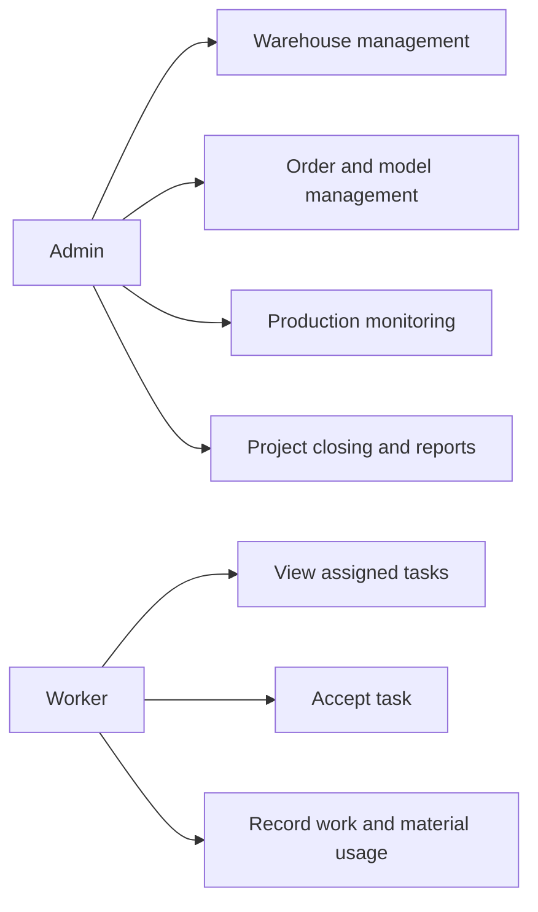
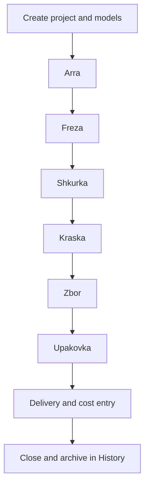

# Diagram Index

The following diagrams are **drafts**. Update after PM-approved scope and roles.

## Use Case — high-level

## Production Activity

## Remaining design work
- Formal UML Use Case with confirmed role permissions
- C4 Context / Container
- ER Diagram based on clarified inventory rules
- Sequence diagrams for material receipt, issue, production discrepancy, project closing
