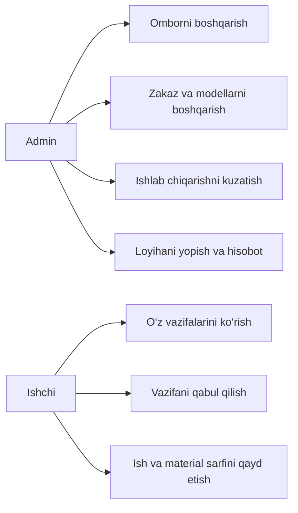
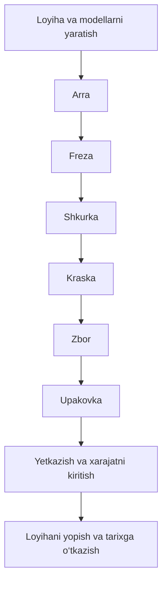

# Diagrammalar ro‘yxati

**Holat:** Dastlabki chizmalar. Rollar va jarayonlar PM tomonidan tasdiqlangach takomillashtiriladi.

## Foydalanish holatlari — umumiy ko‘rinish

## Ishlab chiqarish jarayoni

## Keyingi chizmalar

- Rollar tasdiqlangach to‘liq UML foydalanish holatlari diagrammasi.
- Tizimning asosiy qismlari va ularning aloqalari.
- Ombor qoidalari aniqlashgach ma'lumotlar bazasi aloqalari (ER diagramma).
- Material kirimi, chiqimi, detal nomuvofiqligi va loyiha yopilishi uchun ketma-ketlik diagrammalari.
